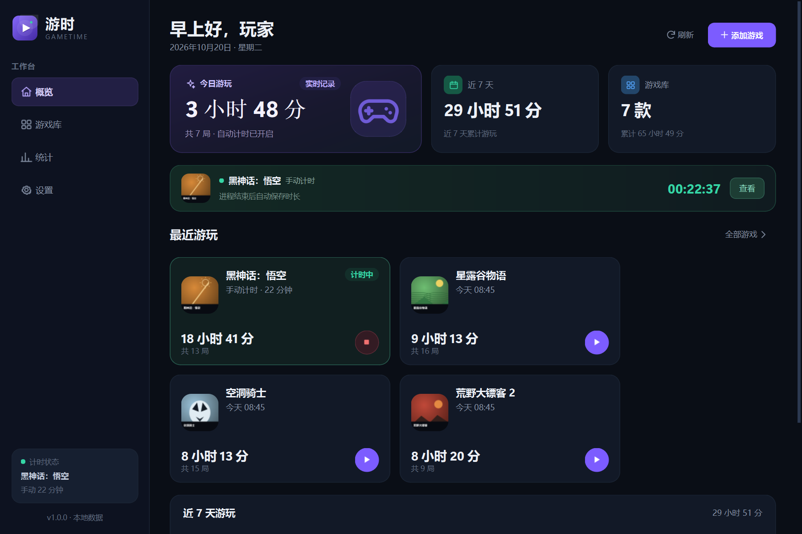
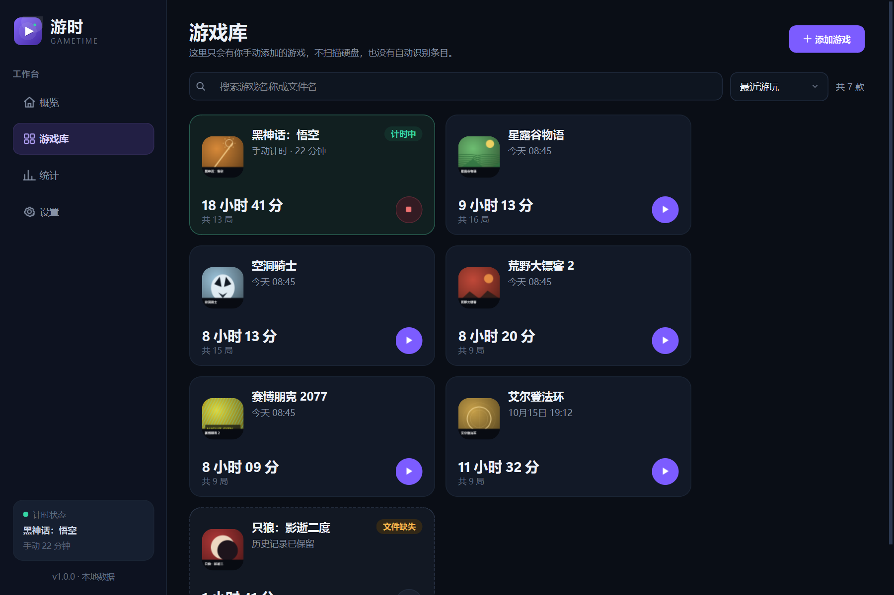
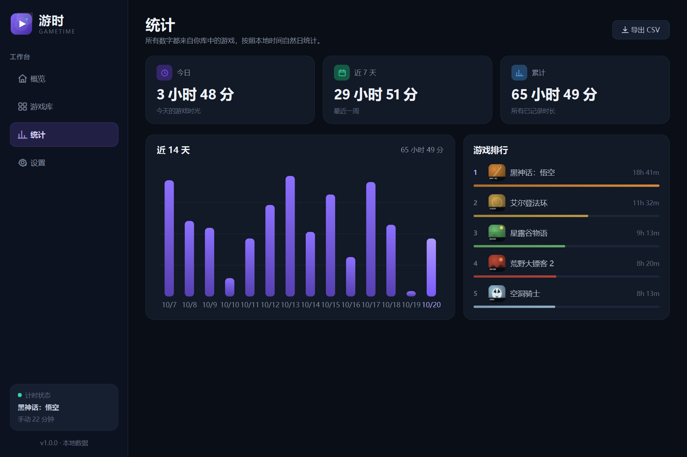

# 游时 GameTime · 产品说明文档

> 版本：1.0.0  
> 平台：Windows 10 / 11 x64  
> 文档日期：2026-10-20  
> 产品形态：绿色便携版（解压即用，无需安装）

---

## 1. 产品概览

**游时（GameTime）** 是一款本地优先的 Windows 桌面游戏助手。它专注于一件事：**把你手动加入游戏库的桌面游戏，准确、安静地记录下来。**

它和 Steam / Epic 的时长统计互不依赖，也不扫描硬盘寻找游戏。你添加哪一款游戏的 `.exe`，它才记录哪一款。即使游戏被移动或卸载，名称、图标和全部历史仍然保留，不会出现“未知游戏”或问号占位。

### 设计原则

| 原则 | 落地方式 |
|---|---|
| 手动添加，不做游戏发现 | 游戏库只显示用户通过“添加游戏”加入的条目；后台进程扫描只用于判断这些已知 exe 是否在运行 |
| 记录准确 | 2 秒轮询、进程退出即结束、10 秒心跳持久化、睡眠大间隔不计时 |
| 卸载后不丢记录 | 添加时永久缓存图标和名称；exe 消失后只显示「文件缺失」，保留历史，可重新定位 |
| 本地优先 | SQLite + 本地图标缓存，无账号、无云端、无网络请求 |
| 界面克制 | 深色单栏 + 四页导航，不堆叠弹窗，不需要学习成本 |
| 不打断游戏 | 关闭主窗口进入托盘继续计时；默认不弹系统通知 |

### 界面一览



| 游戏库 | 统计 |
|---|---|
|  |  |

| 游戏详情 | 卸载后的游戏 |
|---|---|
|  |  |

---

## 2. 功能清单

### 2.1 手动添加桌面游戏

- 在「添加游戏」中选择 `.exe` 启动程序。
- 自动读取文件版本信息中的产品名，读取失败则回退到文件名。
- 自动从 exe 提取图标并永久保存为 PNG；提取失败时生成品牌色字母封面。
- 支持填写备注，最长 500 字。
- 同一路径只能添加一次（Windows 路径大小写不敏感）。
- 支持编辑名称、备注和重新选择程序。
- 只有 `.exe` 且文件真实存在时才允许保存。

### 2.2 双轨计时

**自动计时（默认）**

- 每 2 秒检查一次当前进程的 exe 路径。
- 只有路径与游戏库中某款游戏完全一致的进程，才会开始/结束计时。
- 适合直接从游戏 exe 启动的单机游戏。
- 游戏已经在运行、之后才添加进库，也会在下一轮被识别。
- 退出游戏后自动写入结束时间，无需手动停止。

**手动计时（兜底）**

- 在游戏详情中点击「开始手动计时」，再次点击结束。
- 适合：游戏由启动器拉起另一个 exe、游戏以管理员权限运行导致路径不可读、模拟器/特殊封装程序。
- 手动会话不受进程扫描影响，直到用户主动结束。
- 游戏文件丢失时，仍在进行的手动计时可以正常结束，不会丢失已记录时长。

### 2.3 游戏库

- 卡片式游戏列表，展示缓存图标、名称、累计时长、对局数、上次游玩时间。
- 搜索：按游戏名称或 exe 文件名即时过滤。
- 排序：最近游玩 / 游玩时长 / 名称。
- 运行状态：绿色「计时中」，卡片高亮。
- 文件状态：exe 不存在时显示「文件缺失」与「历史记录已保留」。
- 快捷按钮：未开始时启动游戏；手动计时中显示停止按钮；自动计时中点击进入详情。
- 一键添加、编辑、移除。

### 2.4 详情与历史

- 大图标、名称、路径、备注、当前状态。
- 总时长、对局数、近 7 天、上次游玩四个指标。
- 近 7 天柱状图（按该游戏单独统计）。
- 最近 9 条会话记录，区分自动 / 手动与进行中状态。
- 启动游戏、手动计时、编辑、移除。
- 游戏缺失时显示明显但克制的「文件缺失」提示条，提供重新定位。

### 2.5 统计

- 今日、近 7 天、累计时长。
- 近 14 天柱状图，按本地自然日统计。
- 游戏排行 Top 5，按累计时长排序，并显示相对进度条。
- 跨午夜的会话按时长比例拆分到两个自然日。
- 今日概览显示今日对局数。

### 2.6 系统托盘

- 关闭主窗口时最小化到托盘，计时不中断（默认开启）。
- 托盘左键单击显示/隐藏主窗口；双击显示。
- 托盘菜单：打开主界面、当前计时状态、退出游时。
- 托盘提示会显示正在计时的游戏名称。
- 提供启动计时通知开关（默认关闭，避免打扰）。

### 2.7 设置

| 设置项 | 默认 | 说明 |
|---|---|---|
| 关闭窗口时最小化到托盘 | 开 | 关闭主窗口继续计时 |
| 开机自动启动 | 关 | 写入当前用户 HKCU Run，无需管理员 |
| 启动时直接最小化到托盘 | 关 | 开机自启始终使用托盘模式 |
| 开始计时时显示通知 | 关 | Windows 通知，可能受系统勿扰设置影响 |

还提供：

- 打开数据目录。
- 导出 UTF-8 BOM CSV，可直接用 Excel 打开。
- 显示数据目录、版本与技术栈。

### 2.8 卸载后的行为（重点）

游时从设计上消除了“未知游戏”状态：

1. **添加即缓存**：名称、图标、强调色、路径写入数据库；图标另存为 PNG。
2. **不自动清理**：游戏文件消失后，不删除、不隐藏、不改名该条目。
3. **图标不依赖 exe**：显示缓存的图标；缓存丢失时用游戏名生成字母封面，而不是问号或未知图标。
4. **状态准确**：显示「文件缺失」和「历史记录已保留」，这是文件状态，不是未知游戏。
5. **历史照常统计**：总时长、对局、排行等继续包含该游戏。
6. **可恢复**：重新定位到新 exe 后，记录与图标继续使用。
7. **由用户决定删除**：只有用户主动「移除」并确认后，才删除条目及其历史。

相关截图见第 1 节「卸载后的游戏」。

---

## 3. 使用说明

### 3.1 启动与首次使用

1. 解压 `GameTime-1.0.0-win64-portable.zip` 到任意目录（不要只解压 exe，`_internal` 必须一起保留）。
2. 双击 `GameTime.exe`。
3. 点击右上角「添加游戏」。
4. 选择游戏启动程序，确认名称后保存。
5. 正常启动游戏，或从游时点击启动按钮。
6. 游戏进程出现后，卡片会显示「计时中」；进程退出后自动保存。

首次运行会在 `%LOCALAPPDATA%\GameTime` 创建数据目录：

```
%LOCALAPPDATA%\GameTime\
├─ gametime.db          SQLite 数据库
├─ icons\               永久缓存游戏图标
├─ logs\gametime.log    运行日志
└─ exports\             默认 CSV 导出目录
```

无需管理员权限，也不写入 Program Files。

> 便携版未做代码签名，Windows SmartScreen 可能会提示“未知发布者”。可选择「更多信息 → 仍要运行」。如果安全策略不允许，可自行用代码签名证书签名 exe。

### 3.2 添加游戏

- 推荐选择真正的游戏主程序，而不是 Steam/Epic 客户端或启动器。
- 游戏名称可以自定义；留空时会尝试使用文件版本信息中的名称。
- 图标会被复制到数据目录，原游戏卸载或换图标后仍保留添加时的封面。
- 同一个 exe 不能重复添加；如果游戏已搬家，请在详情中使用「重新定位」，不要重复添加。

### 3.3 计时流程

**自动计时**

1. 游戏库中已有该游戏。
2. 对应的 exe 进程启动。
3. 轮询发现路径匹配 → 创建自动会话。
4. 进程结束 → 结束会话并写入总时长。
5. 主窗口关闭到托盘时，轮询继续。

**手动计时**

1. 打开游戏详情。
2. 点击「开始手动计时」。
3. 玩完后回到游时，点击「结束手动计时」。
4. 会话以“手动”标记写入历史。

> 同一款游戏同一时间只会有一个进行中的会话。自动会话进行时，手动按钮会变为“自动计时中”；手动会话进行时，自动扫描不会重复创建会话。

### 3.4 游戏卸载 / 移动 / 删除

- **卸载或移动**：无需任何操作。下次刷新后显示「文件缺失」，历史保留。
- **重装到新位置**：打开详情 →「重新定位」→ 选择新 exe。名称、图标、历史全部保留。
- **彻底移除**：详情 →「移除」→ 确认。会同时删除该游戏的所有计时记录，不可撤销。
- 游时不会在启动时扫描磁盘，也不会自动删除失效条目。

### 3.5 关闭、托盘与退出

- 点击窗口关闭按钮：默认隐藏到系统托盘，计时继续。
- 托盘左键单击：显示/隐藏主窗口。
- 托盘右键：打开主界面 / 查看当前计时 / 退出游时。
- **退出游时**会结束进行中的会话并保存；下次启动时游戏若仍在运行，会立刻开始一个新会话。
- 关闭“关闭窗口时最小化到托盘”后，关闭窗口将直接退出。
- 如果系统托盘不可用（例如 Explorer 异常），关闭窗口会直接退出，避免窗口不可找回。

### 3.6 快捷键

| 快捷键 | 功能 |
|---|---|
| `Ctrl + N` | 添加游戏 |
| `Ctrl + F` | 进入游戏库并聚焦搜索框 |
| `Esc` | 关闭当前游戏详情窗口 |

### 3.7 数据备份与导出

- 备份：退出游时后复制整个 `%LOCALAPPDATA%\GameTime` 目录。
- 迁移：将同一目录复制到另一台电脑的相同位置。
- 导出：设置 → 导出 CSV；或在统计页点击「导出 CSV」。
- CSV 为 UTF-8 BOM，包含游戏名、路径、开始/结束时间、秒/分钟、计时方式、状态。

---

## 4. 框架与技术选型

### 4.1 技术栈

| 层 | 技术 | 版本 | 作用 |
|---|---|---|---|
| 语言 | Python | 3.14.3 | 业务逻辑、UI、打包脚本 |
| GUI | PySide6 / Qt | 6.12.0 | 原生桌面控件、系统托盘、文件对话框、高 DPI |
| 数据 | SQLite | 3.x（Python 内置） | 游戏、会话、设置持久化，WAL 模式 |
| 进程 | psutil | 7.2.2 | 枚举进程与 exe 路径 |
| 打包 | PyInstaller | 6.20.0 | Windows x64 绿色版 |
| 测试 | pytest | 9.1.1 | 单元、服务、UI、真实进程集成测试 |

### 4.2 为什么选择 Python + PySide6

- **原生体验**：Qt Widgets 是原生 C++ 控件封装，窗口、托盘、文件选择器、高 DPI 行为都与 Windows 一致，不需要套一层浏览器。
- **开发效率**：游戏计时、SQLite、图标、进程、CSV 等逻辑用 Python 实现直接、可测试；本项目核心服务不依赖 GUI，便于自动化验证。
- **运行开销可控**：相比 Electron，省去 Chromium；便携目录约 121 MB，压缩包约 51 MB。
- **系统集成成熟**：`QSystemTrayIcon`、`QProcess`、`QFileIconProvider`、`QStandardPaths`、`QLocalServer` 等能力可直接使用。
- **许可友好**：PySide6 采用 LGPLv3（也可购买商业许可），本软件以动态链接方式使用 Qt，可闭源分发；随包附带第三方声明。

### 4.3 考虑过但未采用的方案

| 方案 | 未采用原因 |
|---|---|
| Electron + Node | 包体和内存开销大；对一个托盘小工具来说过重 |
| Tauri + Rust + WebView | 需要 WebView2 运行时与 Rust 工具链；UI 仍要写 Web，开发与打包复杂度更高 |
| C# / WPF | Windows 原生体验很好，但用户明确优先 Python；跨层迭代与本项目测试工具链不如 Python 直接 |
| Tkinter | 自带、轻量，但高 DPI、托盘、图标、现代视觉与复杂布局能力不足 |
| Qt/C++ | 性能与体验合适，但开发成本高，计时逻辑与测试迭代慢 |

**结论：** 对这个“原生 Windows 小工具 + 本地数据 + 托盘常驻”的需求，Python + PySide6 是开发效率、界面质量和运行成本的平衡点。

### 4.4 架构

```
┌──────────────────────────────────────────────────────────────┐
│                         UI 层（PySide6）                      │
│  MainWindow ─┬─ DashboardPage   LibraryPage   StatsPage      │
│              ├─ SettingsPage                                 │
│              ├─ AddGameDialog / GameDetailDialog             │
│              └─ QSystemTrayIcon / QMenu / Toast              │
└───────────────────────┬──────────────────────────────────────┘
                        │ 信号 / 方法调用
┌───────────────────────▼──────────────────────────────────────┐
│                         服务层                                │
│  TrackingEngine ── ProcessScanner(psutil)   GameLauncher     │
│  GameService ── IconService(Qt)            StatsService      │
│  SettingsStore ── AutostartManager(winreg)  Export(CSV)      │
└───────────────────────┬──────────────────────────────────────┘
                        │
┌───────────────────────▼──────────────────────────────────────┐
│                      持久化 / 系统层                          │
│  SQLite(WAL) + icons/*.png + logs + QLocalServer + 注册表     │
└──────────────────────────────────────────────────────────────┘
```

### 4.5 代码结构

```
gametime/
├─ app.py                 入口、日志、单实例、样式、异常钩子
├─ database.py            SQLite schema 与所有 SQL
├─ models.py              Game / Session / ActiveRun / Overview
├─ paths.py               数据目录、资源路径
├─ windows.py             路径规范化、版本信息、深色标题栏、AppUserModelID
├─ services/
│  ├─ library.py          游戏库 CRUD、校验、重定位
│  ├─ icons.py            exe 图标提取、永久缓存、字母封面
│  ├─ processes.py        进程 exe 路径扫描
│  ├─ tracking.py         自动/手动会话状态机、心跳、恢复
│  ├─ stats.py            自然日聚合、跨午夜拆分、排行
│  ├─ launcher.py         QProcess 启动游戏
│  ├─ settings.py         设置、HKCU 开机自启
│  └─ export.py           CSV 导出
└─ ui/
   ├─ main_window.py      主窗口、导航、托盘、Toast、生命周期
   ├─ pages.py            概览/游戏库/统计/设置四页
   ├─ dialogs.py          添加/编辑/详情/确认
   ├─ dialogs_confirm.py  提示与确认
   ├─ widgets.py          卡片、图表、开关、流式布局等
   ├─ icons.py            内联 SVG 图标
   ├─ theme.py            深色主题 QSS
   └─ formatting.py       时长/日期/文本格式化
```

---

## 5. 关键实现

### 5.1 “只记录添加过的游戏”如何成立

`ProcessScanner` 每轮返回系统中所有可读进程的规范化 exe 路径集合。`TrackingEngine` 只做两件事：

1. 取游戏库里的所有游戏；
2. 用游戏 exe 路径与进程集合求交集。

没有目录扫描、没有进程名猜测、没有商店 API。未知的 exe 即使正在运行也不会被加入游戏库。

进程路径匹配规则：

- `os.path.abspath` + `normpath`；
- Windows 下 `normcase`，大小写不敏感；
- 去掉 `\\?\` 前缀；
- 只做完整路径匹配，不做模糊匹配。

### 5.2 会话状态机与时间精度

```
idle ──进程出现 / 手动开始──> active ──进程退出 / 手动结束 / 应用退出──> completed
```

- UI 每 2 秒调用 `TrackingEngine.poll()`。
- 每次轮询对进行中的会话累计 `min(now - last_tick, 5)` 秒：
  - 正常轮询间隔 2 秒，按实际时长累计；
  - 电脑睡眠/休眠或事件循环卡顿产生大间隔时，最多只算 5 秒，避免把睡眠时间算成游玩。
- 每 10 秒写一次 `last_heartbeat` 与累计时长。
- 正常退出、移除游戏、进程退出时立即完成会话。
- 应用异常退出后，下次启动将遗留的 active 会话以最后一次心跳时间结束，最多损失 10 秒，而不是虚增数小时。
- 所有时间戳以 Unix 秒（UTC）存储，显示时转换为本地时间。

### 5.3 统计规则

- 自然日以本机时区 00:00 为界。
- 一条跨午夜的会话按时长在墙钟区间中的占比拆分到两天。
- 今日 / 近 7 天 / 近 14 天都从会话时长聚合，不额外估算。
- 排行按游戏累计秒数降序。
- 活动会话以已持久化的时长参与统计；在 UI 的实时计时区域另显示精确到秒的“进行中”。

### 5.4 图标持久化与卸载状态

- 添加游戏时调用 `QFileIconProvider` 从 exe 提取图标，保存为 `icons/game_<uuid>.png`。
- 提取不到图标时用名称首字与品牌色绘制 256×256 封面。
- 数据库只存相对文件名，读取时校验路径必须位于 icons 目录内。
- 游戏文件消失后，**不会调用任何“未知应用”图标逻辑**；UI 优先读取缓存 PNG，缓存也丢失时立即用名称生成字母封面。
- 卡片和详情只显示 `文件缺失` 状态与保留提示，用户可重新定位或主动移除。

### 5.5 单实例与托盘

- `QLocalServer` + `QLocalSocket` 实现单实例，服务名包含用户与数据目录哈希。
- 第二个实例把 `show` 消息发给第一个实例后退出；第一个实例恢复并置前窗口。
- 关闭窗口默认只 `hide()`，不停止计时。
- 托盘可用性检查：如果系统托盘不可用，关闭窗口直接退出，防止应用“消失且无法找回”。
- 托盘菜单对象由主窗口持有，避免 Python GC 导致菜单失效。
- 开机自启写 `HKCU\Software\Microsoft\Windows\CurrentVersion\Run`，不请求管理员权限；每次启动若检测到已开启，会刷新为当前 exe 路径，便携目录移动后仍可自启。

### 5.6 数据库

```sql
games(
  id, name, exe_path, exe_name, icon_file, accent, notes,
  created_at, updated_at
)
sessions(
  id, game_id → games.id ON DELETE CASCADE,
  started_at, ended_at, duration_seconds, last_heartbeat,
  source CHECK(auto/manual), status CHECK(active/completed)
)
settings(key PRIMARY KEY, value)
```

关键约束/索引：

- `games.exe_path` 唯一（`COLLATE NOCASE`）。
- 每个游戏最多一个 `status='active'` 的会话（部分唯一索引）。
- `sessions(game_id, started_at DESC)` 索引。
- 外键开启，删除游戏级联删除会话。

### 5.7 本地与隐私

- 无网络请求、无账号、无遥测。
- 数据只写入 `%LOCALAPPDATA%\GameTime`。
- 日志不记录游戏文件内容，只记录启动、计时事件、错误堆栈。
- CSV 导出由用户主动触发。
- 卸载软件不会自动删除数据；用户可手动删除数据目录以彻底清除。

---

## 6. 安装与部署

### 6.1 系统要求

- Windows 10 1809+ / Windows 11，x64。
- 约 120 MB 磁盘空间（解压后）。
- 不需要管理员权限；不需要 .NET、Java、Node.js 或 Python 运行时。

### 6.2 便携版

```
GameTime\
├─ GameTime.exe
├─ _internal\        Qt、Python 运行时与资源
└─ 说明文档.md
```

- 必须保留 `_internal` 目录。
- 可放在任意有写权限的目录；建议不要放在 `Program Files`，以免自启/数据路径限制。
- 解压后运行 `GameTime.exe`。
- 可通过 `--data-dir <目录>` 指定独立数据目录，便于多份数据或测试。
- 包未签名。若需正式分发，建议购买代码签名证书，减少 SmartScreen 提示。

### 6.3 从源码运行

```powershell
python -m pip install -r requirements-dev.txt
python -m gametime
```

### 6.4 构建便携包

```powershell
powershell -ExecutionPolicy Bypass -File .\scripts\build.ps1
```

构建脚本会：

1. 清理旧产物；
2. 用 `GameTime.spec` 运行 PyInstaller；
3. 启动打包后的 exe 做无界面 smoke test；
4. 生成 `dist\GameTime\` 与 `dist\GameTime-1.0.0-win64-portable.zip`。

---

## 7. 测试报告

完整测试命令与结果见 [测试报告](测试报告.md)。以下为摘要。

### 7.1 环境

| 项目 | 值 |
|---|---|
| 操作系统 | Windows 11（10.0.26300）x64 |
| Python | 3.14.3 |
| PySide6 | 6.12.0 |
| psutil | 7.2.2 |
| PyInstaller | 6.20.0 |
| 测试框架 | pytest 9.1.1 |
| 显示环境 | 真实 Windows 桌面 + Qt offscreen（自动化） |

### 7.2 自动化结果

```text
python -m pytest -q
.............................................                            [100%]
45 passed in 5.15s
```

| 测试文件 | 数量 | 覆盖内容 |
|---|---:|---|
| `tests/test_database.py` | 9 | schema、唯一约束、外键级联、会话生命周期、异常恢复、设置、排序搜索 |
| `tests/test_library.py` | 5 | 添加/编辑/重定位/移除、路径校验、重复路径、图标缓存、卸载后元数据 |
| `tests/test_tracking.py` | 9 | 只追踪库内游戏、自动会话、进程退出、睡眠上限、心跳、手动、冲突、退出保存、崩溃恢复 |
| `tests/test_stats.py` | 5 | 今日/7 天/累计、跨午夜拆分、活动会话、空数据、按游戏统计 |
| `tests/test_export_settings.py` | 4 | CSV 编码/字段、设置读写、自启命令 |
| `tests/test_ui.py` | 12 | 主窗导航、添加/重复提示、卸载状态、手动计时、删除、统计、设置、快捷启动、关闭到托盘 |
| `tests/test_process_integration.py` | 1 | 真实 `ping.exe` 进程的启动、识别、计时、退出、入库 |
| **合计** | **45** | |

> 注：真实进程测试把系统 `ping.exe` 复制为独立文件名后运行，避免依赖具体游戏；这是对 `psutil` + 路径匹配 + 会话落库链路的真实集成验证。

### 7.3 打包产物验证

构建脚本自带 smoke test，结果：

```json
{
  "ok": true,
  "version": "1.0.0",
  "data_dir": "...\\build\\packaged-smoke-data",
  "game_count": 0,
  "window_visible": true,
  "theme_loaded": true
}
```

使用演示数据再次启动打包版：

```json
{
  "ok": true,
  "version": "1.0.0",
  "data_dir": "...\\build\\demo-data",
  "game_count": 7,
  "window_visible": true,
  "theme_loaded": true
}
```

打包版正常启动验证：

- `GameTime.exe --data-dir <demo>` 进程存活、`Responding=True`；
- 主窗口标题：`游时 · 桌面游戏助手`；
- Windows 版本信息正确：产品名「游时 GameTime」，文件版本 1.0.0。

### 7.4 单实例 / 开机托盘验证

用打包版执行：

```text
first_running=True  handle_before=0
second_exit=0
first_running_after=True  handle_after=36048228
```

含义：

1. 首个实例使用 `--minimized` 启动，窗口隐藏，托盘运行；
2. 第二个实例正常退出，退出码 0；
3. 第一个实例收到消息后显示主窗口（窗口句柄从 0 变为非 0）。

### 7.5 打包版端到端自动计时

流程：复制 `ping.exe` → 作为游戏加入数据库 → 启动游戏进程 → 启动打包版游时（最小化到托盘）→ 终止游戏进程。

```text
during=[('active', 0)]
after=[('completed', 6)]
```

日志：

```text
game event started: E2E 自动计时 (auto)
game event stopped: E2E 自动计时 (auto)
```

会话由 active 自动完成，时长 6 秒。这验证了打包后的进程扫描、路径匹配、SQLite 写入和退出保存。

### 7.6 Windows 集成项验证

```text
python scripts\verify_windows_features.py

PASS tray_created
PASS tray_open_action
PASS tray_toggle
PASS close_to_tray
PASS tray_notification_api
PASS autostart_registry
ALL_WINDOWS_FEATURE_CHECKS_PASSED
```

该脚本实际创建系统托盘、触发“打开主界面”、切换显示/隐藏、关闭到托盘、调用通知 API，并临时写入/读取/删除 HKCU 开机自启值；结束时恢复原值，当前系统 `is_enabled=False`。

### 7.7 界面验证

7 张截图均由真实 Qt 窗口渲染（非拼图）：

- `01-dashboard.png`：今日概览、计时状态、最近游玩、周图表。
- `02-library.png`：搜索、排序、计时中卡片、文件缺失卡片。
- `03-stats.png`：今日/7 天/累计、14 天图表、排行。
- `04-settings.png`：托盘、开机自启、通知、数据、关于。
- `05-game-detail.png`：详情、统计、会话历史。
- `06-add-game.png`：添加表单、图标预览。
- `07-missing-game.png`：卸载后保留缓存图标、名称与历史，显示「文件缺失」。

### 7.8 测试结论

截至 2026-10-20，本版本的全部 45 项自动化测试通过；打包产物通过 smoke test、真实启动、单实例、托盘、自动计时端到端验证。未发现阻断使用的缺陷。

---

## 8. 已知限制

1. **仅匹配添加时选择的 exe 路径**。如果游戏由启动器启动另一个 exe，或游戏以管理员权限运行导致路径不可读，自动计时可能识别不到；请使用手动计时。
2. **不是反作弊/游戏平台插件**。不注入游戏、不读取游戏内存、不提供 overlay、不统计帧率。
3. **睡眠上限**。轮询间隔超过 5 秒的部分不计入（防止把睡眠算成游玩），因此系统休眠瞬间可能少记最多 5 秒。
4. **异常退出最多损失 10 秒**。依靠 10 秒心跳恢复；强制断电/结束进程时可能丢失最后一个心跳周期。
5. **手动会话需要手动结束**。应用正常退出时会自动结束手动会话；如果崩溃，下次启动会完成并保留已心跳时长，但不会自动续计。
6. **没有云同步与多设备合并**。数据仅本机。
7. **未签名**。首次运行可能被 SmartScreen 或安全软件提示。
8. **托盘依赖 Explorer**。系统托盘不可用时，关闭窗口将直接退出。
9. **Windows 通知可能被系统勿扰模式/通知设置拦截**。
10. **演示截图中的游戏名称仅用于功能展示，图标为项目内生成的抽象图，与游戏官方素材无关。**

---

## 9. 交付物清单

| 路径 | 说明 |
|---|---|
| `dist\GameTime\GameTime.exe` | 可直接运行的便携版主程序 |
| `dist\GameTime-1.0.0-win64-portable.zip` | 便携压缩包（推荐交付） |
| `docs\游时-说明文档.md` / `.docx` / `.pdf` | 本文档（Markdown / Word / PDF） |
| `docs\测试报告.md` | 测试明细与证据 |
| `docs\images\` | 7 张真实界面截图 |
| `gametime\` | 完整 Python 源码 |
| `tests\` | 45 项自动化测试 |
| `GameTime.spec` / `scripts\build.ps1` | 打包配置与构建脚本 |
| `scripts\generate_assets.py` / `scripts\seed_demo.py` | 图标与演示数据生成脚本 |
| `scripts\verify_windows_features.py` | Windows 托盘/自启验证脚本 |

---

## 10. 第三方组件与许可声明

| 组件 | 许可 | 用途 |
|---|---|---|
| Python | PSF License | 运行时 |
| PySide6 / Qt 6 | LGPLv3 / 商业许可 | GUI、托盘、图标、网络 |
| SQLite | Public Domain | 本地数据库 |
| psutil | BSD-3-Clause | 进程枚举 |
| PyInstaller | GPLv2 + 启动器例外 | 打包 |

游时以动态链接方式使用 Qt/PySide6，未修改 Qt 源码。分发时请保留 PySide6/Qt 的 LGPL 许可文本与第三方声明；若需闭源商业分发，请确认 LGPL 动态链接义务或购买 Qt 商业许可。
