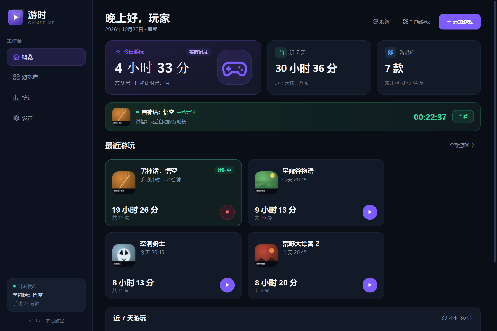
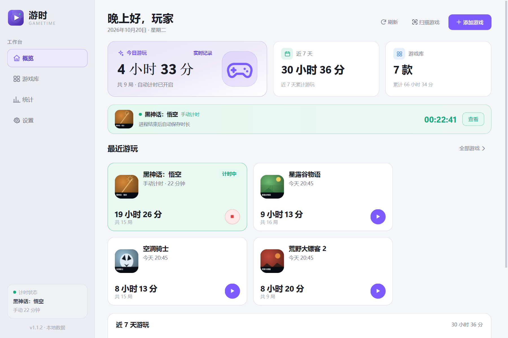
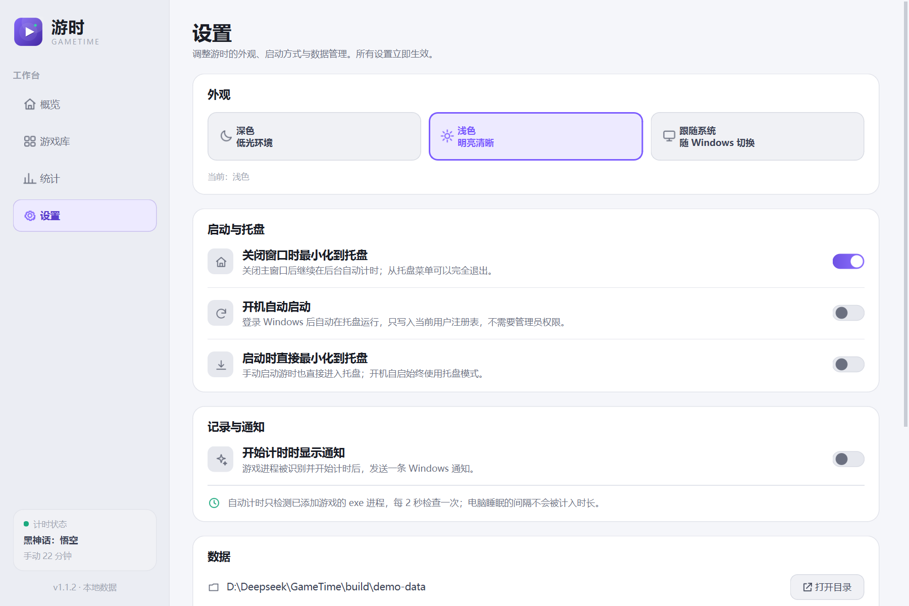
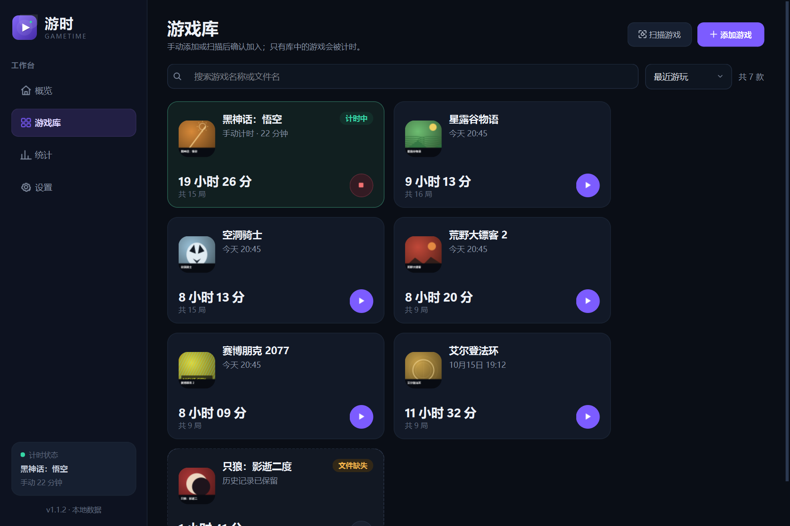
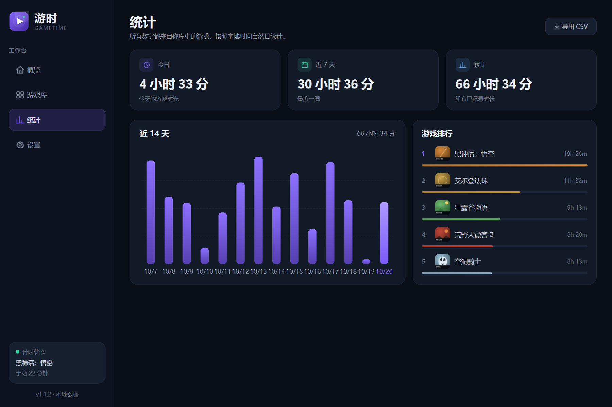
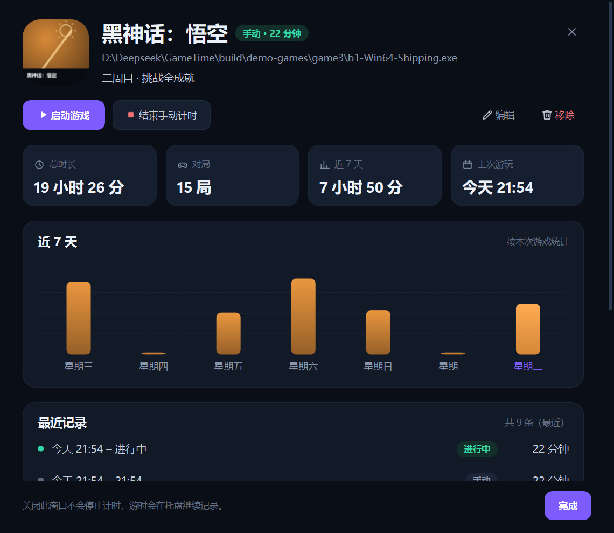

# 游时 GameTime · 产品说明文档

> 版本：1.1.2 · Windows 10 / 11 x64 · 2026-10-20 · 绿色便携版

## 1. 产品概览

**游时（GameTime）** 是一款本地优先的 Windows 桌面游戏助手：**手动添加或按需扫描游戏、自动记录时长、卸载后不丢记录**。

游时不读取 Steam / Epic 的在线账号数据，也不会静默把扫描结果加入游戏库。你可以手动选择游戏 exe，也可以扫描 Steam、Epic 与常见 Games 目录，确认后再添加。游戏被移动或卸载后，名称、缓存图标和历史仍然保留，不会出现“未知游戏”或问号占位。

### 设计原则

| 原则 | 落地方式 |
|---|---|
| 添加可控 | 手动选择，或扫描后勾选确认；绝不静默加入未确认候选 |
| 记录准确 | 2 秒轮询、进程退出即结束、10 秒心跳、睡眠大间隔不计时 |
| 卸载不丢记录 | 添加时永久缓存图标和名称；exe 消失后只显示「文件缺失」，历史保留 |
| 外观可适应 | 深色 / 浅色 / 跟随系统，切换即时生效 |
| 本地优先 | SQLite + 本地图标，无账号、无云端、无网络请求 |
| 不打断游戏 | 关闭主窗口进入托盘继续计时；通知默认关闭 |

### 界面一览



| 概览（浅色） | 设置（浅色） |
|---|---|
|  |  |

| 扫描游戏 | 游戏库 |
|---|---|
|  |  |

| 统计 | 游戏详情 |
|---|---|
|  |  |

---

## 2. 功能清单

### 2.1 两种添加方式

**A. 手动添加**

- 在「添加游戏」中选择 `.exe` 启动程序。
- 自动读取文件版本信息中的产品名；读取失败回退到文件名。
- 自动提取图标并永久缓存；提取失败时生成品牌色字母封面。
- 支持备注、编辑名称、重新选择程序。
- 同一路径只能添加一次；必须选择真实存在的 `.exe`。

**B. 自动扫描后确认**

- 从「游戏库」或「概览」点击「扫描游戏」。
- 扫描来源：
  - **Steam**：读取 `libraryfolders.vdf` 与 `appmanifest_*.acf`；
  - **Epic**：读取 Epic Launcher 的 `.item` manifest；
  - **常见 Games 文件夹**：各盘符的 `Games`、`SteamLibrary/steamapps/common`、`Epic Games`、`GOG Games`、`Ubisoft .../games`、`Origin Games`、`EA Games`、`XboxGames` 等；
  - **全盘扫描**：遍历所有本地固定磁盘，发现自定义安装目录，例如 `D:\APP2\Yslzm\...` 下的《以闪亮之名》；默认开启；
  - **自定义文件夹**：用户可添加任意游戏目录。
- 每个游戏目录按名称相似度、目录层级、文件大小、路径位置评分，挑选最可能的 exe，并过滤安装器、运行库、崩溃处理器、平台启动器、微端/网页客户端和已知工具。
- 全盘扫描会跳过 `Windows`、`WinSxS`、`WindowsApps`、包缓存、开发缓存等目录；用注册表中的安装项改善游戏显示名，例如把 `LifeMakeoverGame` 显示为「以闪亮之名」。
- 结果展示来源、路径和“已添加”状态；已有游戏灰显，不会重复添加。
- 只有勾选「添加选中游戏」后才会写入游戏库。
- 扫描在后台线程执行；默认全盘扫描约需数秒到数十秒，可取消勾选“全盘扫描所有本地磁盘”改用快速扫描；关闭窗口会安全停止扫描。

### 2.2 双轨计时

**自动计时**：每 2 秒检查已添加游戏的 exe 进程，进程出现开始、退出结束。游戏在添加前已经在运行，也会在下一轮被发现。

**手动计时**：详情页开始/结束，适合启动器拉起其他 exe、管理员权限导致进程路径不可读、模拟器等情况。

同一款游戏同一时间只有一个会话。自动会话进行时手动按钮不可用；手动会话进行时自动扫描不会重复创建会话。

### 2.3 游戏库

- 卡片展示图标、名称、累计时长、对局数、上次游玩与状态。
- 按名称/文件名搜索，按最近游玩、时长、名称排序。
- 绿色「计时中」；exe 不存在时显示「文件缺失」与“历史记录已保留”。
- 快捷按钮：启动游戏 / 停止手动计时 / 进入详情。
- 手动添加、扫描添加、编辑、移除。

### 2.4 详情、统计与历史

- 详情：总时长、对局数、近 7 天、上次游玩、近 7 天柱状图、最近 9 条会话。
- 统计：今日、近 7 天、累计、14 天柱状图、游戏排行 Top 5。
- 跨午夜会话按墙钟比例拆分到两个自然日。
- 支持启动、手动计时、编辑、移除、重新定位。

### 2.5 主题外观

- **深色**：原有深色游戏助手风格。
- **浅色**：白色卡片、浅灰背景，适合白天环境。
- **跟随系统**：读取 Windows `AppsUseLightTheme`，运行期间每 3 秒检测变化。

切换会立即更新 QSS、Qt QPalette、原生标题栏、自绘控件、图表、开关、卡片和图标颜色；主窗口会重建并保留当前页面、计时服务与托盘。

### 2.6 托盘、通知与设置

关闭主窗口默认隐藏到托盘，计时继续。托盘菜单可打开主界面、查看计时状态或退出。设置项：

| 设置 | 默认 | 说明 |
|---|---|---|
| 主题 | 深色 | 深色 / 浅色 / 跟随系统 |
| 关闭窗口时最小化到托盘 | 开 | 关闭窗口继续计时 |
| 开机自动启动 | 关 | 写当前用户 HKCU Run，无需管理员 |
| 启动时直接最小化到托盘 | 关 | 开机自启始终使用托盘模式 |
| 开始计时时显示通知 | 关 | 可能受系统勿扰设置影响 |

另提供打开数据目录、CSV 导出、版本与技术栈信息。

### 2.7 卸载后的行为

1. 添加即缓存名称、图标、强调色、路径；图标另存 PNG。
2. 游戏文件消失后不删除、不隐藏、不改名条目。
3. 优先显示缓存图标；缓存丢失时用游戏名生成字母封面，而不是问号。
4. 显示「文件缺失」「历史记录已保留」，不显示“未知游戏”。
5. 总时长、对局、排行继续包含该游戏。
6. 可重新定位到新 exe，记录与图标继续使用。
7. 只有用户主动「移除」并确认后，才删除条目及历史。

---

## 3. 使用说明

### 3.1 首次使用

1. 解压 `GameTime-1.1.2-win64-portable.zip`，保留 `_internal` 文件夹。
2. 双击 `GameTime.exe`。
3. 点击「添加游戏」手动选择，或点击「扫描游戏」挑选候选。
4. 启动游戏，进程出现后自动计时；退出后自动保存。

数据目录：

```
%LOCALAPPDATA%\GameTime\
├─ gametime.db          SQLite 数据库
├─ icons\               永久游戏图标
├─ logs\gametime.log    日志
└─ exports\             默认 CSV 导出目录
```

无需管理员权限；数据只在本机。便携版未签名，SmartScreen 可能提示“未知发布者”，选择「更多信息 → 仍要运行」。

### 3.2 手动添加

选择真正的游戏主程序，而不是平台客户端或启动器。名称可自定义；图标会复制到数据目录。游戏搬家时请用详情「重新定位」，不要重复添加。

### 3.3 扫描添加

1. 点击「扫描游戏」。
2. 默认勾选「全盘扫描所有本地磁盘」，等待后台扫描；如果只需快速扫描平台库，可取消勾选；也可「添加文件夹…」指定自定义目录。
3. 核对候选的名称、路径、来源标签（`Steam` / `Epic` / `全盘扫描` / `自定义文件夹`）。
4. 已有游戏显示「已添加」，不会重复勾选。
5. 勾选需要的游戏，点击「添加选中游戏」。

扫描是按需触发的，不会在启动时自动运行；结果不会自动入库。平台清单通常准确；全盘与目录启发式仍可能列出启动器/工具，请核对后添加。全盘扫描在本机约 10–25 秒，慢速硬盘可能更久，可随时关闭窗口停止。

### 3.4 计时流程

| 场景 | 操作 | 结果 |
|---|---|---|
| 直接启动游戏 | 启动 exe | 2 秒内出现「计时中」，退出后自动结束 |
| 从游时启动 | 点击卡片播放按钮 | 启动游戏并自动计时 |
| 启动器拉起其他 exe | 详情页手动开始/结束 | 按手动会话记录 |
| 管理员运行、路径不可读 | 详情页手动计时 | 避免自动识别失败 |
| 关闭主窗口 | 点击 X | 隐藏到托盘，计时继续 |
| 彻底退出 | 托盘菜单 → 退出游时 | 结束会话并保存 |

### 3.5 卸载、移动与重新定位

- 卸载/移动后无需操作，刷新显示「文件缺失」，历史保留。
- 重装到新位置：详情 →「重新定位」→ 选择新 exe。
- 彻底移除：详情 →「移除」→ 确认，会删除全部历史，不可撤销。
- 游时不会启动时扫描磁盘，也不会自动删除失效条目。

### 3.6 快捷键

| 快捷键 | 功能 |
|---|---|
| `Ctrl + N` | 添加游戏 |
| `Ctrl + Shift + S` | 扫描游戏 |
| `Ctrl + F` | 进入游戏库并聚焦搜索 |
| `Esc` | 关闭当前游戏详情 |

### 3.7 数据备份与导出

退出后复制整个 `%LOCALAPPDATA%\GameTime` 目录即可备份/迁移。CSV 通过设置页或统计页导出，UTF-8 BOM，可直接用 Excel 打开。

---

## 4. 框架与技术选型

### 4.1 技术栈

| 层 | 技术 | 版本 | 作用 |
|---|---|---|---|
| 语言 | Python | 3.14.3 | 业务逻辑、UI、打包脚本 |
| GUI | PySide6 / Qt | 6.12.0 | 原生控件、托盘、主题、高 DPI |
| 数据 | SQLite | 3.x（内置） | 游戏、会话、设置，WAL 模式 |
| 进程 | psutil | 7.2.2 | 进程与 exe 路径枚举 |
| 打包 | PyInstaller | 6.20.0 | Windows x64 绿色版 |
| 测试 | pytest | 9.1.1 | 单元、服务、UI、真实进程集成测试 |

### 4.2 为什么选择 Python + PySide6

- **原生体验**：Qt Widgets 是原生控件封装，窗口、托盘、文件选择器、高 DPI 与 Windows 一致，不套浏览器。
- **开发效率**：计时、SQLite、图标、进程、扫描、主题、CSV 都能直接实现和测试；服务层基本不依赖 GUI。
- **运行开销**：相比 Electron 省去 Chromium；便携目录约 121 MB，压缩包约 51 MB。
- **系统集成**：`QSystemTrayIcon`、`QProcess`、`QFileIconProvider`、`QLocalServer`、`winreg` 可直接使用。
- **主题能力**：QSS + QPalette + 自绘控件足以完成完整深浅色主题。
- **许可**：PySide6 采用 LGPLv3，本项目动态链接 Qt，未修改 Qt 源码。

### 4.3 备选方案

| 方案 | 未采用原因 |
|---|---|
| Electron + Node | 包体和内存开销大，对托盘小工具过重 |
| Tauri + Rust + WebView | 需要 WebView2 与 Rust 工具链；UI 仍要写 Web |
| C# / WPF | Windows 原生体验好，但用户优先 Python，迭代成本更高 |
| Tkinter | 高 DPI、托盘、现代视觉与复杂布局能力不足 |
| Qt / C++ | 体验合适，但开发成本高、迭代慢 |

**结论**：对“原生 Windows 小工具 + 本地数据 + 托盘常驻 + 扫描/主题”的需求，Python + PySide6 是开发效率、界面质量和运行成本的平衡点。

### 4.4 架构

```
┌──────────────────────────────────────────────────────────────┐
│                         UI 层（PySide6）                      │
│  MainWindow ─┬─ Dashboard / Library / Stats / Settings       │
│              ├─ AddGameDialog / ScanGamesDialog              │
│              ├─ GameDetailDialog                             │
│              └─ QSystemTrayIcon / QMenu / Toast              │
└───────────────────────┬──────────────────────────────────────┘
                        │ 信号 / 方法调用
┌───────────────────────▼──────────────────────────────────────┐
│                         服务层                                │
│  TrackingEngine ── ProcessScanner(psutil)   GameLauncher     │
│  GameService ── IconService(Qt)            StatsService      │
│  GameScanner ── ScanThread                 ThemeManager      │
│  SettingsStore ── AutostartManager(winreg)  Export(CSV)      │
└───────────────────────┬──────────────────────────────────────┘
                        │
┌───────────────────────▼──────────────────────────────────────┐
│                      持久化 / 系统层                          │
│  SQLite(WAL) + icons/*.png + logs + QLocalServer + 注册表     │
└──────────────────────────────────────────────────────────────┘
```

### 4.5 代码结构

```
gametime/
├─ app.py                 入口、日志、单实例、主题应用
├─ database.py            SQLite schema 与 SQL
├─ models.py              Game / Session / ActiveRun / Overview
├─ paths.py               数据目录、资源路径
├─ windows.py             路径规范化、版本信息、标题栏明暗
├─ services/
│  ├─ library.py          游戏库 CRUD、校验、重定位
│  ├─ icons.py            exe 图标提取、永久缓存、字母封面
│  ├─ processes.py        进程 exe 路径扫描
│  ├─ tracking.py         自动/手动会话状态机、心跳、恢复
│  ├─ scanner.py          Steam/Epic/目录扫描 + 后台线程
│  ├─ stats.py            自然日聚合、跨午夜拆分、排行
│  ├─ launcher.py         QProcess 启动游戏
│  ├─ settings.py         设置、HKCU 开机自启
│  └─ export.py           CSV 导出
└─ ui/
   ├─ main_window.py      主窗口、导航、托盘、主题重建
   ├─ pages.py            概览/游戏库/统计/设置
   ├─ dialogs.py          添加/编辑/详情
   ├─ dialogs_scan.py     扫描结果确认与批量添加
   ├─ widgets.py          卡片、图表、开关、主题选择器
   ├─ icons.py            内联 SVG 图标
   ├─ theme.py            双调色板、QSS、系统主题检测
   └─ formatting.py       时长/日期格式化
```

---

## 5. 关键实现

### 5.1 计时只针对游戏库

`ProcessScanner` 每轮返回所有可读进程的规范化 exe 路径，`TrackingEngine` 只与游戏库中的 exe 路径求交集。没有目录扫描、进程名猜测或商店 API。扫描发现的候选必须确认后才会入库，因此扫描和计时是两条清晰分离的链路。

路径匹配：`abspath` + `normpath` + Windows `normcase`，去掉 `\\?\` 前缀，完整路径匹配。

### 5.2 自动扫描链路

```
点击“扫描游戏”
  → ScanThread（后台 QThread）
  → Steam / Epic 清单 + Games 目录 + 全盘扫描 + 自定义目录
  → 每个目录挑选最佳 exe
  → ScanResult 列表
  → 用户勾选确认
  → GameService.add_game()
  → 游戏库 / 自动计时
```

- Steam：注册表发现根目录 → `libraryfolders.vdf` → `appmanifest_*.acf` 的 `name`/`installdir` → 目录内选主程序。
- Epic：读取 `%ProgramData%\Epic\EpicGamesLauncher\Data\Manifests\*.item`，优先 `LaunchExecutable`。
- 全盘扫描：枚举所有本地固定磁盘（排除 U 盘/光驱/网络盘），跳过 `Windows`、`WinSxS`、`WindowsApps`、包缓存、开发缓存等目录；按“路径含 game / steamapps / binaries / shipping、文件大小、目录层级”评分，每个目录只取最佳 exe；过滤安装器、运行库、崩溃处理器、平台启动器、微端/网页客户端和已知工具。
- 显示名：优先从注册表卸载项提取“安装目录 → 名称”，因此自定义目录下的 `LifeMakeoverGame...` 会显示为「以闪亮之名」；否则使用最近的游戏目录名。
- 目录启发式：过滤安装器/运行库/崩溃处理器；小于 1 MB 排除；评分综合文件大小、目录层级、名称相似度、`bin`/`Binaries`/`Win64` 位置；每个目录只取一个候选。
- **限制**：扫描是助手，不是识别器；平台清单较可靠，全盘/目录猜测可能把启动器或工具列为候选，所以强制用户确认。全盘扫描耗时取决于磁盘文件数量，本机约 10–25 秒。

### 5.3 主题管理

`ui/theme.py` 维护 `COLORS_DARK` / `COLORS_LIGHT` 和完整 QSS。切换流程：

1. 读取 `dark` / `light` / `system`；
2. `system` 读取 `AppsUseLightTheme`；
3. 更新全局 `COLORS` 和 `QPalette`；
4. 重新生成 QSS；
5. 重建主窗口内容，保留当前页、计时服务和托盘；
6. 更新原生标题栏明暗。

“跟随系统”每 3 秒检测一次；遇到模态对话框或详情窗口时延后应用。

### 5.4 会话与心跳

```
idle ──进程出现 / 手动开始──> active ──进程退出 / 手动结束 / 应用退出──> completed
```

- 每 2 秒轮询，累计 `min(now - last_tick, 5)` 秒；睡眠/卡顿的大间隔最多算 5 秒。
- 每 10 秒持久化 duration 与 last_heartbeat。
- 异常退出后，下次启动以最后心跳结束遗留 active 会话，最多损失 10 秒。
- 时间戳存 UTC Unix 秒，显示转本地时间。

### 5.5 统计、图标与卸载状态

- 统计按本地自然日聚合；跨午夜会话按墙钟重叠比例拆分。
- 添加时永久缓存图标和名称，读取时校验图标路径在 icons 目录内。
- 图标通过 Windows Shell 读取 exe 的真实图标，裁掉透明留白并归一化为 256×256；旧版留下的“小图 + 大留白”缓存会在升级后自动修复一次。
- 文件消失后不触发“未知应用”图标逻辑；缓存丢失时用名称生成字母封面，仍显示「文件缺失」。
- 只有用户确认移除才删除记录。

### 5.6 单实例、托盘与数据库

- `QLocalServer` + `QLocalSocket` 单实例，服务名含用户与数据目录哈希；第二个实例发 `show` 后退出。
- 关闭窗口默认 `hide()`；托盘不可用时直接退出，避免无法找回。
- 开机自启写 HKCU Run；每次启动刷新为当前 exe 路径。
- SQLite：`games`、`sessions`、`settings`；`exe_path` 唯一、每游戏最多一个 active 会话、删除游戏级联删除会话。

### 5.7 本地与隐私

无网络请求、无账号、无遥测。数据仅在 `%LOCALAPPDATA%\GameTime`。扫描只读取本机清单和目录，不上传结果。日志只记录启动、计时事件与错误堆栈，不记录游戏文件内容。

---

## 6. 安装与部署

### 6.1 系统要求

Windows 10 1809+ / Windows 11 x64；约 120 MB 磁盘；无需管理员权限，无需 .NET/Java/Node.js/Python。

### 6.2 便携包

```
GameTime\
├─ GameTime.exe
├─ _internal\
├─ docs\              说明文档与截图
├─ LICENSES\          第三方许可
├─ README.md
└─ THIRD_PARTY_NOTICES.md
```

必须保留 `_internal`；可通过 `--data-dir <目录>` 指定独立数据目录。包未签名，正式分发建议代码签名。

### 6.3 源码与构建

```powershell
python -m pip install -r requirements-dev.txt
python -m gametime
python -m pytest -q

# 打包并自动 smoke test
powershell -ExecutionPolicy Bypass -File .\scripts\build.ps1
```

---

## 7. 测试报告

完整测试见 [测试报告](测试报告.md)。

### 7.1 环境

Windows 11 x64、Python 3.14.3、PySide6 6.12.0、psutil 7.2.2、PyInstaller 6.20.0、pytest 9.1.1。

### 7.2 自动化结果

```text
python -m pytest -q
........................................................                 [100%]
58 passed
```

| 文件 | 数量 | 覆盖 |
|---|---:|---|
| test_database.py | 9 | schema、约束、级联、会话、崩溃恢复、设置、排序搜索 |
| test_library.py | 5 | CRUD、重定位、图标缓存、卸载元数据 |
| test_tracking.py | 9 | 自动/手动、只追踪库内、睡眠上限、心跳、冲突、恢复 |
| test_stats.py | 5 | 今日/7 天/累计、跨午夜、活动会话、空数据 |
| test_export_settings.py | 4 | CSV、设置、自启命令 |
| test_scanner.py | 8 | Steam/Epic manifest、全盘扫描、注册表命名、自定义目录、去重、过滤 |
| test_theme.py | 3 | 调色板、系统跟随、主窗口重建 |
| test_ui.py | 14 | 导航、添加、扫描确认、全盘扫描开关、卸载状态、手动、删除、统计、托盘 |
| test_process_integration.py | 1 | 真实进程识别、计时、退出、入库 |
| **合计** | **58** | |

### 7.3 扫描与主题运行验证

- 实际全盘扫描发现 8 个候选，耗时约 10–25 秒，其中包含自定义目录下的《以闪亮之名》。
- 注册表名称提示将 `LifeMakeoverGame...` 显示为「以闪亮之名」。
- 深色/浅色切换会重建页面并保留当前页；保存浅色后重启，生效主题为浅色。
- 扫描对话框后台线程完成，结果需勾选后添加。
- 界面截图见 `docs/images/`：深色/浅色概览、浅色设置、扫描确认（含《以闪亮之名》）、游戏库、统计、详情、添加、卸载状态。

### 7.4 打包与集成验证

- PyInstaller 打包 + smoke test 通过。
- 演示数据加载：`game_count=7`、`window_visible=true`、`theme_effective=light`（保存浅色时）。
- 单实例：第二实例退出码 0，首实例窗口句柄由 0 变为有效值。
- 端到端自动计时：`active → completed`，自动记录 6 秒。
- Windows 集成：托盘、关闭到托盘、通知 API、HKCU 开机自启全部 PASS。
- 详细原始输出见 `docs/测试报告.md`。

### 7.5 结论

截至 2026-10-20，本版本全部 58 项自动化测试通过；打包版通过 smoke test、单实例、托盘和端到端计时验证；主题切换与扫描确认完成自动化与人工界面检查。

---

## 8. 已知限制

1. 自动扫描是启发式，全盘扫描可能列出启动器/工具，需要用户核对；默认只保留评分较高的候选。
2. 全盘扫描需要遍历所有本地磁盘，耗时随文件数量增加，本机约 10–25 秒；可取消勾选改用快速扫描。
3. 自动计时仅匹配库中游戏 exe 的完整路径；启动器/管理员权限场景请手动计时。
4. 非反作弊/平台插件：不注入游戏、不读取内存、不提供 overlay 或帧率。
5. 睡眠/卡顿间隔超过 5 秒的部分不计入。
6. 异常退出最多损失一个 10 秒心跳周期；手动会话不会自动续计。
7. “跟随系统”依赖 Windows 个性化设置，读取失败回退深色，最多 3 秒延迟。
8. 无云同步；数据仅本机。
9. 未签名，SmartScreen 可能提示“未知发布者”。
10. 托盘依赖 Explorer；不可用时关闭窗口直接退出。
11. Windows 通知可能被勿扰模式拦截。
12. 演示截图中的游戏名称仅用于功能展示，图标为项目内生成的抽象图。

---

## 9. 交付物与许可

| 路径 | 说明 |
|---|---|
| `dist\GameTime\GameTime.exe` | 便携版主程序 |
| `dist\GameTime-1.1.2-win64-portable.zip` | 便携压缩包（推荐交付） |
| `docs\游时-说明文档.md` / `.docx` / `.pdf` | 本文档三格式 |
| `docs\测试报告.md` | 测试明细 |
| `docs\images\` | 界面截图 |
| `gametime\` / `tests\` | 源码与 58 项测试 |
| `GameTime.spec` / `scripts\build.ps1` | 打包配置与构建脚本 |

第三方：Python（PSF）、PySide6/Qt（LGPLv3/商业）、SQLite（Public Domain）、psutil（BSD-3-Clause）、PyInstaller（GPLv2 + 启动器例外）。完整文本见包内 `LICENSES` 与 `THIRD_PARTY_NOTICES.md`。
